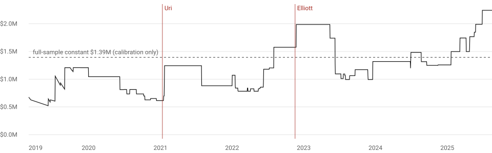

# Starting capital for Stage A (MISO hubs): analysis and default

**Status:** 2026-09-28, revised in rounds 15 and 16 (fixed-cost volume corrected, clearing measured, look-ahead removed). Produces the defaults in `src/evobots/config/capital.py`. Rebuild everything with
`python tools/build_hub_sample.py` then `python tools/capital_analysis.py` (functions) as in section 8.

**Data (all keyless, MISO market-report server, observed):**
- Hub prices: DA ex-post and RT final LMP, 8 trading hubs, every hour **2019-01-01 → 2025-09-21**
  (58,944 hours per hub, no gaps). This stops before the sealed hold-out (2025-09-22 →).
- Virtual volumes: MISO's daily **cleared-bids report** (`YYYYMMDD_bids_cb.zip`, exists from 2023) on the 15th of
  each month, 2023-01 → 2025-09 (33 days, 3,100,347 cleared virtual bids with MW > 0).
- Rules: MISO *Minimum Participation Requirements*, Tariff *Attachment L* (credit policy), *Virtual Trading in MISO* guide (downloaded from cdn.misoenergy.org).

**Your placeholders.** The request left the data path and the sizing rule open, and you delegated both. I built the
sample above, and chose the sizing rule in section 4. Both are marked where they matter.

---

## 1. Hub prices, including the tails

RT LMP, $/MWh, 2019-01 → 2025-09:

| Hub | median | 1st pct | 99th | 99.9th | max | min | % of hours > $500 |
|---|---|---|---|---|---|---|---|
| ARKANSAS | 23.8 | 10.0 | 122 | 448 | 3,481 | -210 | 0.09 |
| ILLINOIS | 24.9 | -0.1 | 148 | 425 | 2,178 | -140 | 0.07 |
| INDIANA | 27.0 | 11.7 | 163 | 537 | 2,412 | -28 | 0.11 |
| LOUISIANA | 25.2 | 11.3 | 138 | 549 | 3,500 | -312 | 0.11 |
| MICHIGAN | 26.5 | 11.2 | 158 | 458 | 2,280 | -37 | 0.08 |
| MINN | 23.2 | -3.1 | 146 | 439 | 1,782 | -79 | 0.08 |
| MS | 24.3 | 10.3 | 122 | 404 | 3,500 | -265 | 0.07 |
| TEXAS | 25.1 | 11.3 | 147 | 784 | 3,500 | -132 | 0.17 |

A virtual trade earns the **spread** s = DA − RT per MWh (INC earns +s, DEC earns −s). Its distribution is what
matters for sizing:

| Hub | mean s | median s | median abs(s) | p95 abs(s) | p99 abs(s) | p99.9 abs(s) | max abs(s) | std | excess kurtosis |
|---|---|---|---|---|---|---|---|---|---|
| ARKANSAS | 0.43 | 1.29 | 2.6 | 21.0 | 66 | 371 | 3,327 | 35.4 | 3,165 |
| ILLINOIS | 0.96 | 2.14 | 4.0 | 31.3 | 92 | 345 | 2,081 | 30.2 | 1,064 |
| INDIANA | 0.58 | 2.26 | 4.0 | 32.5 | 100 | 430 | 2,283 | 33.9 | 1,013 |
| LOUISIANA | 0.45 | 1.65 | 2.8 | 23.9 | 81 | 506 | 3,328 | 43.1 | 1,728 |
| MICHIGAN | 0.59 | 2.35 | 3.9 | 30.7 | 98 | 379 | 2,180 | 31.7 | 1,007 |
| MINN | 0.32 | 1.85 | 4.7 | 35.0 | 95 | 368 | 1,723 | 30.2 | 561 |
| MS | 0.72 | 1.37 | 2.6 | 21.4 | 68 | 321 | 3,202 | 33.8 | 3,322 |
| TEXAS | 0.04 | 1.58 | 2.8 | 25.3 | 89 | 619 | 3,473 | 62.2 | 1,979 |

**What this says:**
- A **typical** hour moves only $2.6–4.7/MWh, but the standard deviation is $30–62 and the excess kurtosis is 560–3,300
  (a normal distribution has 0). The risk is concentrated in rare hours: the maximum is 400–1,300 times the median.
- The mean spread is slightly **positive** at every hub ($0.04–0.96): DA is on average a little above RT, so a
  naive always-INC strategy earns a small premium and occasionally suffers huge losses (RT spikes).
- Spikes cluster in named events: the worst day for an always-INC position is 2022-12-23 (Winter Storm Elliott) and for
  always-DEC 2021-02-18 (Winter Storm Uri).

## 2. Hub volumes: how much virtual trading happens at a hub in an hour

MISO does not publish volume by location. The cleared-bids report lists every cleared virtual bid (MW, cleared
price, INC/DEC, anonymous participant code) but not where it was placed. I attributed a bid to a hub when, in that
hour, the hub was **the only one of ~2,400 locations** with exactly that price (to the cent). Checks:
- The report's price is the DA **ex-ante** LMP: on 2024-06-15 100 % of cleared bids matched an ex-ante node price
  and 86 % matched an ex-post one, so the attribution uses ex-ante prices.
- All hub-matched bids carry a blank Region field (hubs span regions), so a blank Region is required too.
- Hub-hours where another location shares the hub's price are **unobservable** and are left out, not counted as zero.
  Only 25–48 % of hub-hours are observable, and those hours may differ systematically from the rest [a limitation].

Cleared virtual MW in one hub-hour (INC + DEC), observable hub-hours only:

| Hub | observable hub-hours | p10 | **median** | p90 | median DEC / INC | participants (median) | our cap, MW | cap as % of median |
|---|---|---|---|---|---|---|---|---|
| ARKANSAS | 308 (39 %) | 86 | 161 | 314 | 63 / 84 | 12 | 5.0 | 3.1 % |
| ILLINOIS | 219 (28 %) | 215 | 490 | 945 | 80 / 306 | 19 | 5.0 | 1.0 % |
| INDIANA | 307 (39 %) | 428 | 708 | 1293 | 487 / 187 | 22 | 5.0 | 0.7 % |
| LOUISIANA | 202 (26 %) | 71 | 175 | 374 | 100 / 56 | 12 | 5.0 | 2.9 % |
| MICHIGAN | 227 (29 %) | 152 | 367 | 716 | 141 / 174 | 13 | 5.0 | 1.4 % |
| MINN | 374 (47 %) | 196 | 423 | 764 | 214 / 156 | 17 | 5.0 | 1.2 % |
| MS | 265 (33 %) | 22 | 79 | 182 | 22 / 44 | 8 | 4.0 | 5.1 % |
| TEXAS | 272 (34 %) | 56 | 160 | 396 | 87 / 55 | 11 | 5.0 | 3.1 % |

**Context:**
- Market-wide, a median hour clears about **11,800 MW of DEC and 11,600 MW of INC** at all locations.
- At a hub-hour, a single participant's cleared MW has median **8 MW** (25th pct 1.9, 75th 25, 90th 63).
- MISO's minimum bid is "at least 0.1 MW, subject to credit limits and Independent Market Monitor (IMM) volume limits"
  (checked in the *Virtual Trading in MISO* guide). The IMM volume limits are another reason to stay small [values to verify].

## 2b. How many bids clear (round 15)

**What the simulator does.** Clearing is not an assumed fraction. The spec's rule (section 3 of the design spec) is
all-or-nothing and price-taking: a DEC bid clears in full if its bid price ≥ the historical DA LMP, an INC offer if its
offer price ≤ the DA LMP. So every bid whose limit price is satisfied is treated as **fully filled**, and every other
bid as not filled. The simulator does not exist yet (milestone M3); this is its specification.

**Does MISO behave that way?** The cleared-bids report lists every submitted virtual bid-hour with its bid curve (up
to 9 price/MW blocks) and the cleared MW. On the 33 sample days (2023-01 → 2025-09):
- About 7.9M rows have no bid curve and 0 MW. They are placeholder rows with nothing submitted, so they are excluded.
  6.36M real bid-hours remain.
- On single-block bids, the price rule predicts cleared vs not cleared for **99.5 %** of bid-hours market-wide
  (95 % CI over days 99.4–99.6 %; worst day 98.9 %) and **100.0 %** at hubs (worst day 99.6 %).
- Partial fills are rare: 0.16 % of cleared single-block bids on the one day checked in detail (2026-01-15).
- So the all-or-nothing rule matches MISO's clearing, and "every bid whose limit is met fills" is realistic for
  bids of ≤ 5 MW.

**How often other traders' bids clear** (mean over days, 95 % bootstrap CI, day range):

| Where | share of bid-hours cleared | MW-weighted share | days |
|---|---|---|---|
| All locations | 48.8 % [46.1, 51.4], 34–61 % | 56.2 % [54.3, 58.0] | 33 |
| Hubs | **72.1 % [70.7, 73.5]**, 63–80 % | 85.6 % [82.7, 88.4] | 33 |

- By side at hubs, MW-weighted: DEC 83.5 %, INC 89.6 %. Market-wide by year: 40.8 % (2023), 51.9 % (2024), 55.6 % (2025).
- The MW-weighted share exceeds 100 % on one day, because on 3.4 % of bid-hours cleared MW exceeds the largest block
  (some curves look incremental, not cumulative). The row share is unaffected, so it is the number I use.
- The CI treats days as independent. Only the 15th of each month is sampled and the report starts in 2023, so the
  real uncertainty is larger than the interval.

**What this means for the bot.** These rates describe *other traders'* limit prices. In the backtest the bot's own
clearing rate is an **output**, set by its evolved limit prices. A bot with no effective limit (offers at MISO's
−$500 floor, bids at the $1,000 cap) clears 100 %. For capital sizing, 0.721 is only a reference: a bot that bids every
hub-hour with limits as selective as the typical hub bidder's.

## 3. Liquidity cap: small enough not to move the price

The simulator has no market-impact model, so a bot must stay small next to the hub's cleared virtual volume:

    max_mw_per_hub_hour(hub) = min(5 MW, 5 % of the hub's median cleared virtual MW)

- This gives **5 MW at seven hubs and 4 MW at MS.HUB**, which is 0.7–5 % of the median hub-hour. It is also below the
  typical single participant at a hub (8 MW), so the bot is a small participant.
- At the p10 hub-hour (the thinnest 10 %), 5 MW is 1–22 % of cleared volume (22 % at MS). The report card will flag
  bots whose P&L comes mostly from thin hours.
- **Full size** means bidding at the cap in every hour at every hub: **39 MW × 24 h = 936 MWh per day**.

Note: the cap is a property of the **market**, not of capital. That is why, at Stage A, more capital eventually
cannot buy a bigger position (section 5).

## 4. The sizing rule (chosen, since you delegated it)

A rule like "2 % of capital per trade" has no direct meaning here: a virtual bid is sized in MW, has no purchase price,
and a bot places up to 192 bids per day (24 hours × 8 hubs). What capital must cover is the **loss on a bad day**.
So the rule scales every bid a bot makes by

    position_scale = min(1, daily_risk_budget × equity / p99_daily_loss_at_full_size)

- `p99_daily_loss_at_full_size` is the 1-in-100-day loss of the full-size position, on the worse of always-INC and
  always-DEC. In backtests it is the point-in-time trailing estimate (section 4b). The table below uses the whole
  2019–2025 sample and is **calibration only**.
- `daily_risk_budget` = **2 %** by default: a 1-in-100 day costs at most 2 % of equity.
- The evolved size slot of each bot (spec section 7) still chooses a fraction of this; the rule only sets the ceiling.
- Equity is used, not starting capital, so positions shrink after losses and grow after gains.

Full-size daily P&L, 2019-01 → 2025-09 (benchmark positions at the caps):

| Position | mean day | 1-in-100 day loss | 1-in-1,000 day loss | worst day | worst 5 days | worst 20 days |
|---|---|---|---|---|---|---|
| always INC | +474 | 27,897 | 118,855 | 492,173 (2022-12-23) | 503,873 | 484,372 |
| always DEC | -474 | 19,351 | 69,479 | 176,554 (2021-02-18) | 380,617 | 373,652 |

The worst single day is **17.6×** the 1-in-100 day. A risk budget based on the 1-in-100 day therefore still lets
a tail day cost about 35 % of equity at full size. That is intended: it keeps loss limits and the death rule meaningful.

Solving for when bids reach full size, full-sample (calibration): **C_full = 27,897 / 0.02 = $1.39M**. Point-in-time, it varies from $0.52M to $2.24M (section 4b).

## 4b. Look-ahead in the sizing rule (round 15)

**What version 1 did.** The $27,897 figure is the full-sample 1-in-100-day loss (2019-01-01 → 2025-09-21, including
Uri and Elliott). No backtest existed yet, so it was used only for this analysis, the CLI printout and the explorer.
But `capital.py` claimed "measured on trailing data only" with no code behind it. That is now fixed:
- **`src/evobots/sizing.py`** computes the estimate point-in-time. Bids for operating day D are placed on D−1, and
  final RT prices post about 5 days late, so the newest usable day is **D−6**. The window is the 365 most recent
  visible days.
  - **Warm-up fallback:** with fewer than 90 visible days the estimate is `None`, and `position_scale(None) = 0`, so
    the bot does not trade ("do nothing"). From 90 to 365 days the window expands. In the full 2005–2026 run this
    affects only mid-2005; in this 2019+ sample it is 2019-01-01 → 2019-04-05 (95 days).
- **The full-sample value is renamed `CALIBRATION_ONLY_FULL_SAMPLE_P99_USD`**. It lives only in `cli.py`, and a test
  fails if any other module uses it. `capital_sweep()` is labelled calibration-only.
- **Other calibration constants, also fixed across all dates:** the 5 MW liquidity cap (from 2023–2025 volumes) and
  the default capital (chosen knowing the storms). They carry no information about *when* storms happen, but they were
  tuned on data that includes them. The sealed hold-out was not used.

**How the numbers change** (trailing p99, worse of INC/DEC; C_full = p99 ÷ 2 %):

| Decision day | trailing p99 | C_full | note |
|---|---|---|---|
| sample range | $10.4k (2019-07-14) – $44.8k (2025-08-03), median $24.2k | $0.52M – $2.24M, median $1.21M | full-sample constant: $27.9k, $1.39M |
| 2021-02-13 (before Uri) | $12,261 | $0.61M | calm year, so bids were at full size going into Uri |
| 2021-02-18 (Uri's worst day) | $12,261 | $0.61M | the storm is not yet visible |
| 2021-02-25 (Uri visible) | $18,777 | $0.94M | |
| 2021-03-20 | $24,859 | $1.24M | |
| 2022-02-26 (Uri leaves the window) | $16,787 | $0.84M | |
| 2022-12-23 (Elliott's worst day) | $31,519 | $1.58M | 2022 was already volatile |
| 2022-12-31 (Elliott visible) | $39,723 | $1.99M | |
| 2023-12-31 (Elliott leaves the window) | $19,885 | $0.99M | |

*Round 21: the original figure was stored inside Claude Science and did not travel. This one is redrawn by `tools/check_against_claude_science.py` from the archive downloaded in round 20; it reproduces every number in the table above exactly (`data/claude_science_check.csv`).*

**Storm-day losses at $1.5M:**
- Elliott, always-INC: the bid scale is 0.95 (trailing) vs 1.00 (full sample), so the loss is **31.2 %** vs 32.8 %
  of capital.
- Uri, always-DEC: full size in both, **11.8 %**.
- Look-ahead therefore made the rule look slightly *more* conservative before Elliott and made no difference at Uri.
  The trailing version sizes up in calm years and so enters storms at full size.

**The 2 % budget in practice:**
- The rule is designed so the worse direction's 1-in-100 day costs 2 %. With the trailing estimate, that threshold is
  exceeded on **2.2 %** of days (by year 2019 1.9 %, 2020 0.8 %, 2021 1.9 %, **2022 4.7 %**, 2023 0.8 %, 2024 2.2 %,
  2025 3.0 %), because volatility changes faster than a 365-day window.
- At $1.5M, days losing more than 2 % of equity: always-INC 0.30 % (full-sample sizing 0.29 %); always-DEC 0.68 % (0.61 %).
- I keep **2 %** as the default, but the label now says what it delivers: "about 1 day in 50 beyond the estimate,
  more in volatile years", not a guarantee.

## 5. The conditions, and the capital range each allows

**Correction (round 15).** The first version of this table printed "$0.59/MWh" as if it were the full-size figure.
It was not: `capital_sweep()` divided the $50k yearly fixed cost by **cleared** MWh per year,

    cleared_MWh_per_year = position_scale × 936 MWh/day × 365 × cleared_share_of_hub_hours

with `cleared_share_of_hub_hours = 0.25`. That 0.25 was **my assumption**, not measured from your data. It is one
overall number (not per hub or per hour): the share of all hub-hours in which the bot holds a cleared position.
At full size that is 85,410 MWh/year, so $50,000 / 85,410 = $0.585/MWh. At full volume (every hub-hour cleared,
341,640 MWh/year) the figure is $50,000 / 341,640 = **$0.146/MWh**, as you calculated.
The parameter is now named, documented, and shown under three values:

Capital sweep, 2 % budget, 5 MW cap, $50k fixed yearly costs (full-sample sizing; calibration only):

| Capital, $ | bid size (% of cap) | fixed $/MWh, share 1.0 | fixed $/MWh, share 0.721 | fixed $/MWh, share 0.25 | worst 20 days, % of capital | headroom above $1M floor / worst 20-day loss, point-in-time sizing |
|---|---|---|---|---|---|---|
| 250,000 | 18 % | 0.82 | 1.13 | 3.27 | 34.7 | below floor |
| 500,000 | 36 % | 0.41 | 0.57 | 1.63 | 34.7 | below floor |
| 750,000 | 54 % | 0.27 | 0.38 | 1.09 | 34.7 | below floor |
| 1,000,000 | 72 % | 0.20 | 0.28 | 0.82 | 34.7 | below floor |
| 1,250,000 | 90 % | 0.16 | 0.23 | 0.65 | 34.7 | 20.0 % / 29.6 % |
| 1,400,000 | 100 % | 0.15 | 0.20 | 0.59 | 34.6 | 28.6 % / 26.4 % |
| 1,500,000 | 100 % | 0.15 | 0.20 | 0.59 | 32.3 | 33.3 % / 24.6 % |
| 2,000,000 | 100 % | 0.15 | 0.20 | 0.59 | 24.2 | 50.0 % / 18.4 % |
| 3,000,000 | 100 % | 0.15 | 0.20 | 0.59 | 16.1 | 66.7 % / 12.3 % |
| 5,000,000 | 100 % | 0.15 | 0.20 | 0.59 | 9.7 | below floor |

**(1) Fixed costs ≤ $1 per cleared MWh.** The floor capital is

    C_min = F × p99 / (budget × $1/MWh × 936 × 365 × share)        (capital_floor_for_fixed_costs)

| Interpretation | share | cleared MWh/year at full size | fixed $/MWh at full size | C_min (full-sample p99 $27.9k) | C_min (trailing p99, median $24.2k / max $44.8k) |
|---|---|---|---|---|---|
| Full volume: every hub-hour bid and cleared | 1.000 | 341,640 | 0.146 | **$204k** | $177k / $328k |
| Cleared volume: every hub-hour bid, clearing at other traders' hub rate (section 2b) | 0.721 | 246,421 | 0.203 | **$283k** | $245k / $455k |
| Previous assumption: selective bot | 0.250 | 85,410 | 0.585 | $817k | $707k / $1,313k |
| Very selective bot | 0.100 | 34,164 | 1.46 | never | never |

- Below a cleared share of **14.6 %**, fixed costs exceed $1/MWh even at full size, **whatever the capital**. The
  selectivity axis of the MAP-Elites map reaches such bots, so condition (1) cannot be guaranteed by capital for every
  niche at Stage A. Fitness charges fixed costs, so those bots pay them honestly.
- Per-MWh charges (MISO fees, RSG uplift [rates to verify at M0]) scale with MWh, so capital does not change their
  share of P&L. MISO clears in an auction, so there is no bid-ask spread.

**(2) Liquidity.** The 5 MW cap holds at every capital. Capital above the full-size threshold sits idle. With
point-in-time sizing that threshold is not a constant: $0.52M–$2.24M over 2019–2025 (section 4b).

**(3) Losses stay meaningful → capital ≤ ~$4.8M** (worst 20 days at full size, $484k, stays above 10 % of capital).

**(4) MISO eligibility, net worth route → capital > $1M.** This is one of seven routes, not a hard requirement (section 6b). Since round 16 it is an optional absolute `ruin_floor_usd`, and the default floor is relative.

**(5, made explicit in round 15) Tail headroom for the individual career.** Version 1 relied on this criterion
without stating it. Starting equity minus the $1M floor must exceed the largest 20-day loss as a share of equity,
measured on the benchmark positions with **point-in-time** sizing (section 4b). Across 2019–2025 that loss is
**26.4 %** of equity at $1.4M, from always-DEC in the window ending 2021-03-08 (Uri). It falls as capital rises,
because bids hit the liquidity cap more often.

**Is $1.5M the lowest round step meeting the conditions?**

| Conditions required | full-volume interpretation | cleared-volume (0.721) interpretation | 0.25 assumption |
|---|---|---|---|
| (1)–(4), your four | **$1.05M** (binding: the $1M floor) | **$1.05M** | **$1.05M** |
| (1)–(5), adding tail headroom (point-in-time sizing) | **$1.40M** | **$1.40M** | **$1.40M** |
| (1)–(5) with full-sample sizing (the look-ahead version) | $1.35M | $1.35M | $1.35M |

So **no**: under your four conditions alone, $1.5M is not the lowest step under either interpretation. I was wrong
to say it was. $1.05M meets them, but an individual there is forced out after a 4.8 % drawdown, i.e. after about two
1-in-100 days. $1.5M is justified only with condition (5).

## 6. Recommended default: still $1,500,000, with the reason corrected

- **$1.40M** is the lowest $50k step that satisfies all five conditions with point-in-time sizing: headroom
  28.6 % > worst 20-day loss 26.4 %, a margin of 2.2 points.
- **$1.5M** adds margin: headroom 33.3 % vs 24.6 %, a margin of 8.7 points. I recommend it over $1.40M for three reasons:
  1. the trailing estimate under-predicts tails (section 4b: its 1-in-100 threshold is exceeded on 2.2 % of days, not 1 %);
  2. condition (5) was measured on 2019–2025 only; the 2005–2018 training years (e.g. the 2014 polar vortex) are not yet checked;
  3. $1.5M is a round number.
- If you prefer the minimum that the data supports, **$1.40M** is defensible. Both are allowed by the slider, and the explorer warns below $1.36M.
- Fixed costs at $1.5M: **$0.146/MWh** at full volume, **$0.203** at the measured hub clearing rate, $0.585 at 25 %.

**Interactive range unchanged:** $250k–$5M, step $50k. The individual preset now warns when headroom is below the
26.4 % tail loss (below about $1.36M) as well as at or below $1M.

## 6b. The ruin floor: a separate setting (round 16)

**The MISO rule, checked in the document.**
- **Source:** MISO FERC Electric Tariff, Attachment L (Credit Policy), version 56.0.0, effective June 3, 2024
  (`cdn.misoenergy.org`, downloaded 2026-09-28), Section III.B "Demonstration of Appropriate Person Status". It reads:
  an applicant "can demonstrate 'appropriate person' status by submitting financial statements which show they have a
  net worth exceeding $1 million or total assets exceeding $5 million."
- **It is one route among several.** MISO's *Minimum Participation Requirements* page lists seven:
  1. an energy business;
  2. a governmental entity;
  3. financial statements (the $1M / $5M rule);
  4. a cash deposit over $5M;
  5. a corporate guaranty from an appropriate person;
  6. an irrevocable letter of credit covering the exposure;
  7. appropriate-person status shown some other way.
- **Minimum capitalization** is a separate test, in Section III.C.
- **Correction:** rounds 14–15 said MISO "requires" more than $1M of net worth. That is too strong. The rule is
  confirmed, but it is not a hard floor for every trader.
- **Not checked:** whether version 56.0.0 is still the current version.

**What the code does now.**
- `ruin_floor_fraction` (default **2/3**) gives a **relative** floor: the career ends when equity falls to 2/3 of
  starting capital, i.e. after a **33.3 % drawdown**.
- `ruin_floor_usd` (default unset) gives an **absolute** floor if you set one. `1000000` reproduces the round-14
  behaviour and is described as "inspired by MISO's eligibility rule".
- An absolute floor that leaves under 10 % of starting capital to lose is **rejected** as an error.
- The default does not depend on the MISO rule.

**Why relative by default.** An absolute $1M floor either kills or nearly kills the bot on day one below about
$1.1M, which is most of the $250k–$5M range. It is also nearly irrelevant at $5M, where it allows an 80 % drawdown.
Clamping the range to above $1.1M would remove the question you asked for ("what capital makes sense"). A relative
floor keeps the career's meaning ("stop after losing a third") the same at every capital, which is what makes
capitals comparable. The 33.3 % value equals the round-14 headroom at $1.5M, so the default run is unchanged.

| Starting capital | $250,000 | $1,050,000 | $5,000,000 |
|---|---|---|---|
| Relative floor (default, 2/3) | $166,667 | $700,000 | $3,333,333 |
| Headroom | 33.3 % | 33.3 % | 33.3 % |
| Worst 20-day loss, point-in-time sizing | 50.4 % | 34.5 % | 8.2 % |
| Verdict | a storm like Uri can end the career (warning) | just fails, by 1.2 points (warning) | survives; drawdown limits rarely bind (warning) |
| Absolute $1M floor instead | **rejected**: below the floor on day one | **rejected**: 4.8 % headroom | $1M floor, 80 % headroom |

**Why the worst 20-day loss depends on capital.** Small accounts are sized by the risk budget alone, and going into
Uri the trailing estimate came from a calm year. Large accounts are capped by liquidity, so they are relatively smaller.
- Values from 2019–2025: $250k–$500k 50.4 %; $1.0M 36.0 %; $1.1M 33.2 %; $1.5M 24.6 %; $2M 18.4 %; $3M 12.3 %; $5M 8.2 %.
- The table is stored as `WORST_20_DAY_LOSS_BY_CAPITAL` and used only for warnings.

**Effect on the default.** With the relative floor, the lowest $50k step at which headroom exceeds the worst 20-day
loss is **$1.10M** (33.3 % vs 33.2 %, a 0.1-point margin). $1.5M keeps a margin of 8.7 points (33.3 % vs 24.6 %),
and its bids are at full size on 80.6 % of days (53.0 % at $1.21M). You are keeping $1.5M, and that value does not
depend on the MISO rule. If you set the absolute $1M floor, $1.5M still passes (33.3 % vs 24.6 %).

## 7. Leverage and margin: yes, a separate setting, and the risk budget is the real one

MISO virtuals have no margin loan. Collateral is set by Attachment L as

    collateral = daily Virtual MWh Limit × MPD × 2 days      (MPD ≥ $12/MWh)

**Why this matters:**
- **Collateral is small next to the risk.** At full Stage A size (936 MWh/day) and MPD $12, MISO asks for only
  **$22,464**, 1.5 % of $1.5M. The worst day costs $492k, **22×** the collateral. Collateral bounds nothing
  economically at Stage A. Losses beyond it are paid from the rest of equity at settlement [settlement timing to verify],
  so the simulator must mark equity daily, not only collateral.
- **The MPD.** Attachment L defines it as the greater of "the highest differential between the Day-Ahead and Real-Time
  Locational Marginal Prices at the 50th percentile over the previous twelve (12) months", reset each May, and a minimum
  of $12.00/MWh (checked in the PDF). At the hubs alone that differential ran $2.3–8.3/MWh in 2020–2025. MISO takes the
  highest over all locations, so the true MPD can be above $12; use MISO's published value [verify at M0].
- **The leverage-like choice is how much of equity may be lost on a bad day.** That is `daily_risk_budget`, separate
  from `starting_capital_usd`. Doubling the budget has the same effect on risk as halving capital, until the liquidity
  cap binds. Keeping the two apart lets you ask "same trader, more aggressive" without changing the career floor.
- `credit_share` (share of capital pledged as collateral, default 25 %) sets the MISO Virtual MWh Limit. At Stage A it
  allows about 15,600 MWh/day, 16× more than liquidity allows, so it never binds here. It is kept because it will at
  stages D and C, and because it models MISO's rules.
- **Interaction with the career floor.** For an individual, the capital that can really be lost is
  starting capital − $1M. At the default that is $500k, or about 1.0 worst Elliott day at full size. The risk budget,
  not capital, is what an aggressive bot evolves against.

## 7b. Storm sensitivity: fitness with and without storm days (round 16)

`src/evobots/storms.py`, `fitness_with_and_without_storms(daily_pnl, starting_capital, storm_windows=None,
ruin_floor_usd=0, rf_annual=0)`, is a **reporting** helper, never used for selection.
- It keeps the bot's own daily returns (P&L ÷ previous equity) and sets the returns on storm days to zero.
- It recompounds with the ruin floor.
- It reports F = ln(W_T/W_0) − rf·T with all days, without all storms, and without each storm alone.
- So it measures "same bot, flat on storm days", not "a world without storms".

**Default windows**, chosen from the data: every day within ±7 days of the event on which the worse-direction
full-size benchmark loss exceeded its full-sample 99th percentile ($36,382):
- **Uri:** 2021-02-15 → 02-19 (5 days, losses $76k–$177k per day at full size);
- **Elliott:** 2022-12-23 → 12-25 (3 days; $492k on the 23rd, $52k on the 25th).

You can pass any other `{name: (first, last)}` windows.

**On the benchmarks at $1.5M** (point-in-time sizing, 2 % budget, relative floor $1M):

| Benchmark | F, all days | F, without storms | Uri's contribution | Elliott's contribution | Ruined? |
|---|---|---|---|---|---|
| always-INC | 0.540 | 0.684 | +0.069 | −0.212 | no |
| always-DEC | −0.411 | −0.409 | −0.002 | 0.000 | yes (2022-01-21) |

The always-INC benchmark's ~6.7-year log-growth is 0.14 lower because of the storms. Nearly all of that is Elliott.
A bot that ranks high only because of Uri will show a large positive "Uri contribution".

## 7c. Proposal (not implemented): a per-bot size gene

**Gene.** Each bot carries one number g ∈ [0.05, 1.0] (mutated by ×exp(N(0, 0.2)), clipped to the range). On every
bid, the bot's MW become

    MW(hub, hour, day) = floor_to_0.1( g × position_scale(day) × cap(hub) ),   0 if below MISO's 0.1 MW minimum
    position_scale(day) = min(1, daily_risk_budget × equity(day−1) / p99_bot(day))

**Bounds, and what each guarantees.**
1. **g ≤ 1 and position_scale ≤ 1**, so MW ≤ cap(hub). The liquidity cap can never be exceeded.
2. **g ≥ 0.05**, so the gene cannot switch a bot off. Not trading is the job of the formula's `when` rules;
   otherwise a bot could hide in a niche by never trading.
3. **The daily budget.** The current p99 is the worse of **always-INC and always-DEC**. A bot that mixes directions
   across hubs can lose more: the absolute bound (every hub-hour on the losing side) has a full-sample p99 of
   $43,418 vs $27,897 (**1.56×**; median 1.41× and maximum 8.79× on trailing data). So even today, with g = 1, the
   2 % budget is **not guaranteed** for mixed-direction bots. With a gene, I would change `p99_bot` to the larger of:
   - the bot's own trailing 365-day p99 loss at g = 1 (point-in-time, from its own simulated positions), and
   - 1.0× the single-direction benchmark p99 (so a bot with little history is not sized up).

   Then g × budget is the budget actually used, and g ≤ 1 keeps it within the daily budget, up to estimation error
   (the trailing estimate is exceeded on 2.2 % of days).

**What I would test before adding it.**
1. **Invariants (property tests):** for random bots and genes, MW ≤ cap at every hub-hour; MW ∈ {0} ∪ [0.1, cap];
   the budget-exceedance rate at g < 1 is no larger than at g = 1.
2. **Does it add variety or just saturate?** Measured already on always-INC at $1.5M: F rises monotonically with g
   (0.126 at g = 0.1, 0.306 at 0.25, 0.502 at 0.5, 0.523 at 0.75, 0.540 at 1.0). The 2 % budget is below the
   Kelly size, so log-growth selection will push profitable bots to g ≈ 1. The gene would then mostly add variety
   among weak bots. I would run MAP-Elites with and without it on synthetic data first and add it only if the
   archive's g values do not collapse to 1.
3. **Planted-signal test:** on synthetic data with a known edge, the gene must not change which bots are found, only
   their size.
4. **Storm sensitivity:** check whether small-g bots are simply storm-avoiders (compare `storm_contribution` across g).

## 8. Implementation

| File | What it holds |
|---|---|
| `src/evobots/config/capital.py` | `CapitalSettings` (frozen dataclass): defaults, bounds, validation, formulas, `warnings()`. Round 16 added: `ruin_floor_fraction` (default 2/3), `ruin_floor_usd` (optional absolute), `effective_ruin_floor_usd()`, `headroom_fraction()`, per-hub caps `hub_caps_mw()` / `hub_liquidity_mwh_per_day()` (936 MWh/day), the volume constants `HUB_MEDIAN_CLEARED_VIRTUAL_MW`, and the calibration table `WORST_20_DAY_LOSS_BY_CAPITAL` with `worst_20_day_loss_fraction()`. |
| `src/evobots/sizing.py` | point-in-time `trailing_p99_daily_loss()` (365 days, newest usable day D−6, 90-day warm-up), `trailing_p99_series()`, `simulate_benchmark_equity()` |
| `src/evobots/storms.py` | **new**: `fitness_with_and_without_storms()`, `storm_days()`, `DEFAULT_STORM_WINDOWS` (reporting only) |
| `src/evobots/config/__init__.py` | `load_capital(config_path, overrides)`: code defaults < TOML `[capital]` < command line |
| `src/evobots/cli.py` | `python -m evobots.cli capital [config] --starting-capital … --ruin-floor-fraction … --ruin-floor-usd …`. It now prints the per-hub caps (936 MWh/day), the ruin floor and the headroom. |
| `configs/10_miso_hubs.toml` | the `[capital]` table |
| `tools/capital_explorer.html` | sliders for capital, risk budget, cap, fixed costs, cleared share, ruin-floor share (or an absolute floor), and career; caps rounded to 0.1 MW as in `capital.py` |
| `tools/capital_analysis.py` | rebuilds every number here. Round 16 added `explorer_expected()`, the Python twin of the explorer. |
| `tests/` | `test_capital.py` (14), `test_sizing.py` (9), `test_floor_caps_storms.py` (**17, new**), 40 in total |

The new tests include:
- the relative floor at $250k / $1.05M / $1.5M / $5M;
- an absolute floor below 10 % headroom being rejected;
- the default not depending on the MISO rule;
- the **CLI/analysis match**: the settings' per-hub footprint must equal the analysis value of 936 MWh/day; the volume
  constants must equal `docs/hub_volume_stats.csv`; the CLI must print "936 MWh" and never "960";
- the storm helper checked by hand (log 0.9 for a −10 % storm day; sizing fractions kept; ruin reported; the input
  series not mutated; custom windows).

## 9. What is measured and what is still assumed (updated in round 16)

**Measured from MISO data or documents:**
- hub price and spread distributions (2019-01 → 2025-09);
- hub cleared virtual volume (33 days, attributable hub-hours only);
- clearing rates and the accuracy of the price rule;
- the trailing p99 path and storm-window behaviour;
- storm-day contributions for the benchmarks;
- the worst 20-day loss as a function of capital;
- the mixed-direction tail ratio (1.56× full sample);
- **Attachment L III.B, the $1M net worth / $5M assets route (confirmed in v56.0.0)**;
- the $12 minimum MPD, the 2-day VMEW and the 0.1 MW minimum bid.

**Assumed (not measured):**
1. **$50k/year fixed costs.**
2. **The bot's cleared share of hub-hours.** It is an output of each bot; 1.0 / 0.721 / 0.25 are scenarios.
3. **The ruin floor of 2/3 of starting capital** (a 33.3 % drawdown). A design choice matching the round-14 headroom
   at $1.5M, not a measured behaviour of traders.
4. **The benchmark positions** as the stress test. Mixed-direction bots can lose up to 1.56× more on a 1-in-100 day,
   so the 2 % budget is not guaranteed for them (section 7c).
5. **The 2 % budget, 365-day window, 90-day warm-up and 5-day RT lag.** The lag is from one observation.
6. **The 5 MW / 5 % liquidity cap** as a stand-in for "no price impact". The volumes are from 2023–2025 and cover
   25–48 % of hub-hours.
7. **Storm windows** (±7 days of the named events, p99 threshold): a rule of thumb.
8. **Whether Attachment L v56.0.0 is the current version**, and the unverified MISO parameters (fees, RSG, the
   published MPD, IMM limits, settlement timing).
9. **The explorer is not run-tested in a browser.** Expected values are in section 10.
10. **Tails before 2019:** see section 11.

## 10. Expected values for checking the explorer in a browser (round 16)

Computed by `tools/capital_analysis.py: explorer_expected()`, a line-by-line Python twin of the explorer's
`update()`. Explorer settings: 2 % risk budget, 5 MW cap, $50k fixed costs, **cleared share 0.72** (the slider's
default), ruin-floor share 0.667, absolute floor blank. These use the full-sample p99, i.e. calibration only.

| Capital | Share of cap used | Fixed cost per cleared MWh | Worst 20 days, % of capital (full-sample sizing) | Ruin floor | Headroom | Worst 20 days, point-in-time (table) |
|---|---|---|---|---|---|---|
| $1,500,000 | 100.0 % | $0.203 | 32.3 % | $1,000,000 | 33.3 % | 24.6 % |
| $1,050,000 | 75.3 % | $0.270 | 34.7 % | $700,000 | 33.3 % | 34.5 % |
| $5,000,000 | 100.0 % | $0.203 | 9.7 % | $3,333,333 | 33.3 % | 8.2 % |

- Full-size footprint: **936 MWh/day** in all three cases.
- At cleared share 1.0, the fixed cost is $0.146 (at $1.5M and $5M) and $0.195 (at $1.05M).
- The old stated values ($0.59/MWh, 32.3 %) were computed at a 0.25 share. The 32.3 % is unchanged, since it doesn't
  depend on the share; the $0.59 was stale.
- Warnings expected: at $1.5M, none. At $1.05M, the headroom warning. At $5M, the "worst 20-day loss is under 10 %"
  and "capital well above the full-size point" warnings.

## 11. Does the breach rate hold before 2019? (optional check, round 16)

**Data.** Hub DA/RT prices 2015-03-01 → 2018-12-31 from MISO's monthly `_da_expost_lmp_csv.zip` /
`_rt_lmp_final_csv.zip` archives: the same builder, file format and hub names as 2019+.
- Seven of the eight hubs are complete from 2015-03.
- **MS.HUB starts in 2017-12**, so before that the footprint is 35 MW (840 instead of 936 MWh/day) instead of 39 MW.
- 2005–2014 was not checked. Those files use an older format, and only four hubs (MINN, ILLINOIS, MICHIGAN,
  CINERGY/INDIANA) have consistent definitions there.
- The run stops at 2025-09-21, so the hold-out stays sealed.

**Result** (trailing 365-day p99, D−6 visibility, 90-day warm-up; the target is 1 %):

| Period | days | breach rate |
|---|---|---|
| 2015-06 → 2018-12 | 1,307 | **1.38 %** |
| 2019 → 2025-09 | 2,456 | 2.12 % (2.16 % in round 15, which started cold in 2019) |
| 2015-06 → 2025-09 | 3,763 | 1.86 % |

By year: 2015 0.9 %, 2016 1.1 %, 2017 1.6 %, 2018 1.6 %, 2019 1.6 %, 2020 0.8 %, 2021 1.9 %, **2022 4.7 %**, 2023 0.8 %,
2024 2.2 %, 2025 3.0 % (`docs/trailing_breach_rate_by_year_2015_2025.csv`).

**Reading.**
- The estimator under-predicts in every period except the calm years (2015, 2020, 2023).
- 2015–2018 is closer to the target (1.4 %) than 2019–2025 (2.1 %). The recent period is more volatile, so the
  2.2 % figure is not a 2019–2025 artefact; if anything it is the pessimistic end.
- The largest 2015–2018 full-size loss was $68.7k (2018-01-18), about one-seventh of Elliott's $492k.
- So the worst 20-day table (section 6b), measured on 2019–2025, is not undercut by 2015–2018.
