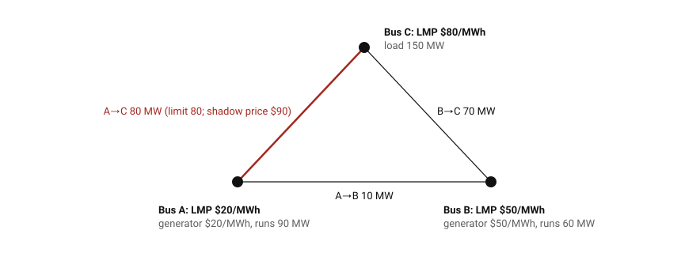

# Where locational prices come from (O0)

An explanation for readers new to electricity markets (`CLAUDE.md` §20.3). The formulas, with the worked example, are in [maths.md](../maths.md) §2. The code is `src/evobots/orfe/dc_opf.py`, and the tests in `tests/test_dc_opf.py` check every number below.

## 1. The operator's problem
Every hour, MISO chooses how much each generator runs so that supply meets demand at the lowest total offer cost. The grid limits that choice: each transmission line can carry only so many MW. Power cannot be steered down a chosen path; it spreads over all parallel paths in proportion to how easily each conducts. The **power transfer distribution factors** (PTDFs) describe that spread: the share of 1 MW, injected at one bus and taken out at a reference bus, that crosses each line.

The resulting problem, the **optimal power flow**, is a linear program in the "DC" approximation: flows linear in injections, no losses.

## 2. Prices are shadow prices
The LMP at a location is what one more MW consumed there would add to the total cost. In the linear program, that is the **dual** (shadow price) of the power-balance constraint, adjusted by the duals of any line limits that bind. MISO publishes it every hour at every node, split into three parts:
- **energy (MEC):** the price at the reference;
- **congestion (MCC):** the effect of binding lines;
- **losses (MLC):** left out of the DC model, so zero here. In MISO's data it is small at the hubs: a median 2.5 % of the DA price, 90th percentile 6.1 % (obs., round 26: 471,446 hub-hours, 2019–2025, from the hub table).

## 3. A three-bus example

*Drawn by `tools/build_opf_figure.py` from the solved model; the binding line is red.*

**The setup** (illustrative numbers, not MISO data):
- three buses joined by three identical lines;
- a cheap generator ($20/MWh) at A and an expensive one ($50/MWh) at B;
- 150 MW of load at C;
- the line A–C limited to 80 MW.

**Without the limit,** A would serve all 150 MW. Two-thirds of A's output would flow directly to C (100 MW) and one-third round through B. That breaks the 80 MW limit.

**With the limit,** A can run only 90 MW: 60 MW goes direct, 30 MW round through B. A's 90 MW plus B's 60 MW put exactly 80 MW on A–C. The cost is $4,800.

**The prices that come out:**

| Bus | LMP | Congestion component | Why |
|---|---|---|---|
| A | $20/MWh | −$60 | one more MW of load at A is met by A, and it doesn't touch the binding line |
| B | $50/MWh | −$30 | met by B's own generator |
| C | **$80/MWh** | 0 (reference) | one more MW at C needs B to run 2 MW more and A 1 MW less: 2 × 50 − 20 = $80 |

The price at C is **higher than either generator's cost**. That isn't a mistake; it is what congestion does. The binding line's shadow price is $90: one more MW of line capacity would save $90 an hour.

The split into energy and congestion depends on the reference bus; the LMPs do not. With A as the reference, the energy component is $20 and C's congestion component is +$60. MISO's reference is a load-weighted set of buses rather than one bus [verify].

## 4. Why this matters for virtual bids
A virtual bid earns RT − DA at its node. Congestion is where the two markets disagree most: a line forecast in the day-ahead market to have room may bind in real time, or the reverse. Then the congestion component, and with it the spread, jumps at the nodes on either side. That is why:
- the feature `congestion_share_28d` (`CLAUDE.md` §8) measures how much of a location's recent price came from congestion;
- the virtual-bidding literature finds the largest spreads at congested nodes (CLAUDE.md §12.3).

Hubs average many nodes, so their congestion components partly cancel. That is one reason Stage A, the hubs only, is the calm place to start.

## 5. Limits of the DC model
- **No losses:** real LMPs have a loss component (MLC).
- **No voltage or reactive power:** these can also bind in practice.
- **Constant costs:** generators' marginal costs are constant here; real offers are stepped curves, and the commitment of start-up and minimum-load costs is a mixed-integer problem. The RSG uplift (`market_rules.md` §3) exists because of those costs.
- **A 3-bus network, against MISO's ~2,000 priced nodes:** the mechanism is the same; the scale is not.
