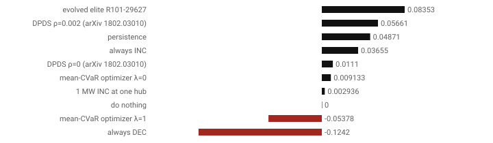
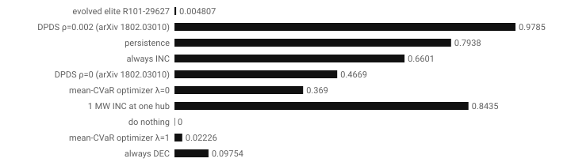
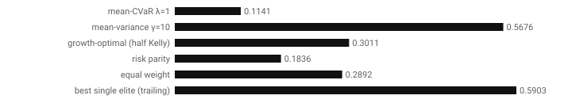
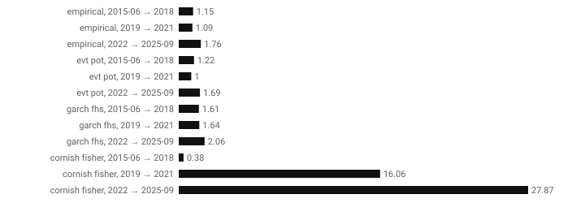

# Evolving virtual-bidding traders for MISO, judged as careers

*A write-up of the evobots project and its operations-research and financial-engineering (ORFE) track. Every number is computed by a script in this repository and links to its output. Citations are to [references.md](../references.md), where each was checked against Crossref, arXiv or a named record; anything else is marked [verify].*

## 1. Problem
- **The market.** A virtual bid in MISO's day-ahead market is a financial position at one location and hour.
  - A **DEC** (virtual demand) buys at the day-ahead price (DA) and sells back at the real-time price (RT): it earns RT − DA per MWh.
  - An **INC** (virtual supply) does the opposite: it earns DA − RT.
  - Bids carry a limit price, clear only if DA is on the right side of it, and pay fees and uplift.
- **The question.** Can a search over small, readable trading rules find one that would have survived and grown as a *career*, with real capital, sizing and death, and that still works on data the search never saw? And when it can't, can the system say so instead of shipping an overfitted rule?
- **Why MISO.** None of the eight arXiv papers on electricity virtual bidding we read in full studies MISO, and none uses evolutionary or quality-diversity search (`docs/design_spec.md` §1).

## 2. Market rules
Settlement, fees with MISO's netting, collateral, the Virtual MWh Limit, and the timing of what is public when are in [market_rules.md](../market_rules.md). The simulator implements them ([maths.md](../maths.md) §4).
- **Decision time:** 10:30 Eastern on D − 1.
- **What a trader sees:** DA prices through D − 1 and final RT prices through D − 6.
- **Fees:** labelled estimates until MISO's Rates Factors file is in `data/inbox/`.

## 3. Data and point-in-time design
- **Prices:**
  - MISO DA and final RT LMPs, 2005-04-01 → 2025-09-21, every priced location, parsed from MISO's own files;
  - Stage A is the trading hubs; Stage C is all 1,471–2,594 locations; Stage D is yearly cluster representatives ([data_coverage.md](../data_coverage.md); round 40).
  - MISO data is used non-commercially, with credit, and is never redistributed.
- **Other inputs:** NWS forecast highs and lows (IEM archive), Henry Hub gas, policy uncertainty (EPU), the EIA-860M fleet. The 25 features are in [features.md](../features.md).
- **Sealed hold-out:** 2025-09-22 → 2026-09-21 (§7.2 of the spec). Only `assess/final_test.py` can open it, and every opening is logged. It is scored once per finished run.
- **Forward data:** 2026-09-22 on is for paper trading.
- **Point-in-time:** every input goes through `visible()`, and a test checks that no feature changes when future data is altered.

## 4. Models
### 4.1 The trader and the search
- **The trader:**
  - a typed genetic-programming program with three slots: *where* (a location filter), *when* (a day and hour filter) and *score*;
  - numeric genes: side thresholds, limit offset, size, pause rule, daily cap.
  - Its standalone Python source is generated, and parses back into the same genome.
- **The search:** MAP-Elites (mouret2015) over a 10 × 8 map of net direction × selectivity.
  - parents by rank-weighted selection; an adaptive bandit over the operators;
  - 5-year rolling windows stepped by a year, with every elite re-evaluated when the window moves;
  - each elite also scored on the next unseen year.
- **Fitness:** F = E[ln(W_T/W_0) − r_f·τ] − 0.002·nodes, after a career model ([maths.md](../maths.md) §5):
  - L0, death when out of money;
  - L3, a quit hazard fitted to 44 / 24 / 15 % survival at 1 / 2 / 3 years (barber2020);
  - L4, a CUSUM edge check (page1954).

### 4.2 The deployment gates (O7)
A trader is deployable only if it passes:
- **G1 survival:** stationary bootstrap (politis1994).
- **G2 skill against the number of trials:** the deflated Sharpe ratio (bailey2014dsr) with the effective number of trials, and MinBTL (bailey2014charlatanism).
- **G3 overfitting:** the probability of backtest overfitting (bailey2017pbo).
- **G4 doubled costs.**
- **G5 scale-up:** at the MW cap, and on every location.
- **G6 walk-forward year.**
- **G7 shock periods.**
- **G8 the sealed year.**

Across strategies:
- White's Reality Check (white2000);
- Hansen's SPA (hansen2005spa);
- Romano–Wolf step-down (romano2005);
- the model confidence set (Hansen, Lunde & Nason 2011 [verify]).

Formulas: [maths.md](../maths.md) §6.

### 4.3 The ORFE modules
Formulas for each: [maths.md](../maths.md) §7.
- **O1 scenarios:** block bootstrap, a two-state regime model with Student-t emissions, mean-reverting jumps, analogue days; scored by CRPS and pinball loss.
- **O2 optimisation bidders:**
  - a sample-average mean-CVaR linear program (rockafellar2000), solved by HiGHS;
  - its perfect-foresight bound;
  - DPDS (baltaoglu2018), read from the paper, with its stated deviations.
- **O3 portfolios of elites:** mean-CVaR, mean-variance, growth-optimal and fractional Kelly, risk parity, equal weight.
- **O4 a battery:** perfect foresight (LP/MILP), rolling intrinsic, stochastic dynamic programming, tuned and evolved threshold policies (powell2019's policy classes).
- **O5 risk:** VaR₉₉/ES₉₉ by empirical, EVT peaks-over-threshold, GARCH-filtered historical simulation and Cornish–Fisher; backtested by Kupiec (kupiec1995), Christoffersen (christoffersen1998) and Acerbi–Székely (acerbi2014).
- **O8 the search as an OR problem:**
  - successive halving;
  - OCBA (chen2000ocba);
  - NSGA-II (deb2002) against MAP-Elites by hypervolume;
  - CMA-ES (hansen2001; Hansen's 2016 tutorial [verify]).
- **O9 price impact:** a fixed-effects regression of the spread on net cleared virtual MW ([explanations/price_impact.md](../explanations/price_impact.md)).

## 5. Experimental protocol
- **Common rules:** every strategy class is scored under one protocol ([orfe/leaderboard.py](../../src/evobots/orfe/leaderboard.py)):
  - the same days and the same point-in-time data;
  - the same sizing rule, credit limit, fees and doubled-fee stress;
  - the same career model;
  - trial counts kept per class, so each class's deflated Sharpe is fair to it.
- **The unseen year** for the leaderboard is the year after R101's last training window: 2024-03-28 → 2025-03-27.
- **The evolution run R101:** 30,000 traders over 15 rolling windows (round 37).

## 6. Results
### 6.1 The evolution run: "do nothing" ([round 38](../rounds/round38_m7_report_card.md))
- **No trader passed the quick gates.** The nearest candidate, R101-29627 ("frosty-raven"), INCs every hub-hour where yesterday's DA + 0.41 × EPU exceeds about $117/MWh.
- **Its unseen year:** +0.050 log growth with a 3 % drawdown.
- **Why it still fails:**
  - G2 on its last window: deflated Sharpe 0.28 against 1,024 effective trials;
  - G3 across the archive: PBO 0.76;
  - Reality Check p = 0.50;
  - its edge disappears without EPU, a series whose history may hold revised values.
- **Report card:** [data/report_R101-29627.json](../data/report_R101-29627.json).

### 6.2 The methods leaderboard ([data/orfe/leaderboard.json](../data/orfe/leaderboard.json))

| Strategy | Class | Trials | Log growth | Deflated Sharpe |
|---|---|---|---|---|
| perfect foresight (bound, not a strategy) | bound | 1 | +1.101 | – |
| evolved elite R101-29627 | evolved | 27,167 | +0.084 | 0.00 |
| DPDS ρ = 0.002 | online | 2 | +0.057 | 0.98 |
| persistence | baseline | 1 | +0.049 | 0.79 |
| always INC | baseline | 1 | +0.037 | 0.66 |
| DPDS ρ = 0 | online | 2 | +0.011 | 0.47 |
| mean-CVaR LP λ = 0 | optimisation | 2 | +0.009 | 0.37 |
| 1 MW INC at one hub | baseline | 1 | +0.003 | 0.84 |
| do nothing | baseline | 1 | 0.000 | – |
| mean-CVaR LP λ = 1 | optimisation | 2 | −0.054 | 0.02 |
| always DEC | baseline | 1 | −0.124 | 0.10 |

- **Highest growth isn't skill.** The evolved elite has the highest growth, but against 27,167 trials its Sharpe ratio is what luck would produce.
- **The best deflated Sharpe** belongs to DPDS with variance aversion: a two-setting online algorithm from the literature.
- **The model confidence set (α = 0.10) keeps every strategy:** one year can't separate them.

### 6.3 Scenarios ([data/orfe/scenarios.json](../data/orfe/scenarios.json); 189 test days, 2022-02 → 2025-09)
| Generator | CRPS | Pinball | Excess kurtosis | Cross-hub correlation |
|---|---|---|---|---|
| analogue days | **4.38** | **2.03** | 297 | 0.65 |
| regime (t emissions) | 4.67 | 2.19 | 2,122 | 0.02 |
| block bootstrap | 4.78 | 2.20 | 226 | 0.54 |
| real data | – | – | 296 | 0.63 |

- **Analogue days forecast best** and reproduce the tails and the cross-hub correlation.
- **The regime model's t tails are far too heavy.** Its hour-and-hub pattern, drawn from a different day, loses the correlation between hubs.

### 6.4 Portfolios of elites ([data/orfe/portfolio.json](../data/orfe/portfolio.json))
Walk-forward, re-weighted monthly over R101's 80 elites, 2015-03 → 2025-03. The elites were evolved through these years, so this is out of sample for the weights only.

| Model | Log growth | Annual Sharpe | Worst day | Average holdings |
|---|---|---|---|---|
| best single elite (trailing) | +0.590 | 1.07 | −14.0 % | 1.0 |
| mean-variance γ = 10 | +0.568 | 0.98 | −15.8 % | 1.2 |
| growth-optimal, half Kelly | +0.301 | 1.07 | −7.0 % | 1.1 |
| equal weight | +0.289 | 0.89 | −3.9 % | 80 |
| risk parity | +0.184 | 0.62 | −3.8 % | 50.2 |
| mean-CVaR λ = 1 | +0.114 | 0.42 | −4.7 % | 1.7 |

- **The concentrated models win on growth and lose on worst day.**
- **Diversification halves growth and cuts the worst day by three quarters.**

### 6.5 The battery ([data/orfe/battery.json](../data/orfe/battery.json))
- **Setup:** 5 MW / 20 MWh at ILLINOIS.HUB, 82 % round trip, $2/MWh wear, 3,858 days. End-of-day energy is settled at the day's mean price.

| Policy | Revenue | Share of the bound |
|---|---|---|
| perfect foresight | $875,452 | 1.00 |
| rolling intrinsic (yesterday's DA as forecast) | $659,488 | 0.75 |
| stochastic DP | $225,122 | 0.26 |
| threshold, tuned | $101,779 | 0.12 |
| threshold, evolved | $100,305 | 0.11 |

- **Yesterday's price shape is most of the value.**
- **The single-threshold policies lose money in 2021 and 2022**, when price levels jumped.
- **Evolution matched tuning but didn't beat it.**

### 6.6 Risk backtests ([data/orfe/risk.json](../data/orfe/risk.json))
The series is always-INC at full size, 99 % one-day VaR. Each cell gives the breach rate and the Kupiec p-value.

| Estimator | 2015-06 → 2018 | 2019 → 2021 | 2022 → 2025-09 |
|---|---|---|---|
| empirical (the sizing rule) | 1.15 %, p 0.60 | 1.09 %, p 0.76 | 1.76 %, p 0.01 |
| EVT peaks-over-threshold | 1.22 %, p 0.43 | 1.00 %, p 0.99 | 1.69 %, p 0.02 |
| GARCH-filtered HS | 1.61 %, p 0.04 | 1.64 %, p 0.05 | 2.06 %, p 0.001 |
| Cornish–Fisher | 0.38 %, p 0.01 | 16.1 %, p 0.00 | 27.9 %, p 0.00 |

- **EVT passes every test in 2019–2021.**
- **Every estimator fails in 2022–2025,** where breaches cluster (Christoffersen independence p < 0.01).
- **Cornish–Fisher breaks down** at the data's excess kurtosis.

### 6.7 The search as an OR problem ([data/orfe/search.json](../data/orfe/search.json))
- **Same budget:** 1,500 evaluations, window 2014-03 → 2019-03.
- **Hypervolume:** NSGA-II 0.259 against MAP-Elites 0.245; NSGA-II's front has 50 points against 23.
- **The unseen next year:** MAP-Elites' best scores +0.004 and NSGA-II's −0.021. A wider front isn't a better deployable trader.
- **Successive halving** costs 224 trader-years against 320 for scoring everyone fully, and keeps the full ranking's top three.
- **OCBA** puts 56 of 60 re-evaluations on the best elite and its closest rival.

### 6.8 Price impact ([explanations/price_impact.md](../explanations/price_impact.md))
- **Estimate:** β = −0.0008 $/MWh per MW, 90 % interval −0.008 to +0.006. There is no detectable impact, and the estimate is associational.
- **Sensitivity:** at the interval's upper end, impact costs R101-29627 0.0014 of log growth on its unseen year.

### 6.9 Scale-up (M8; round 40)
- **G5 at every location:** the trader re-scored over its unseen year with ≈ 2,500 locations (`evobots.assess.scale_up`).
- **Stage D against Stage A** (same seed, 2,000 traders, windows from 2013; [round 40](../rounds/round40_m8_scale_up.md)):
  - both runs decide "do nothing" for the same reason, G2: deflated Sharpe 0.11 against 205 effective trials at Stage D, 0.01 against 204 on the hubs;
  - the Stage D search finds higher training fitness (+0.389 against +0.110 in the last window) at about 45 times the cost per trader (1.3 s against 0.03 s per trader-window).
- **G5 at every location** (R104's nearest candidate, unseen year 2023-12-31 → 2024-12-29): +0.191 log growth on 2,642 locations (it traded at 2,531), against +0.206 on its own 263. The edge survives scaling up, but the trader still fails G2 and G3.

## 7. Limitations
- **Fees and uplift are estimates** until MISO's Rates Factors file is supplied.
- **Hub attribution.** The cleared-bids attribution covers only observable hub-hours.
- **Revised series.** EPU and the gas series are today's histories, not vintages. `evobots paper --fetch` keeps daily vintages from now on.
- **Short battery comparison.** The battery's stochastic DP uses one scenario model; better forecasts would raise its share.
- **Portfolio results** are out of sample only for the weights.
- **One evolution run** (plus the Stage D comparison) on one seed. Search variance is not yet measured across seeds.

## 8. What an honest "no edge" means
"Do nothing" is the deployable decision of R101. It is a result, not a failure:
- **The search found a rule that looks profitable**, survived storms and made money on its unseen year.
- **The gates found why that isn't enough:**
  - after 27,167 tries, a Sharpe ratio of its size is what the best of many random rules reaches;
  - in-sample winners are usually not out-of-sample winners (PBO 0.76);
  - its edge rides on a revisable series.
- **The detection limit.** Even 20.5 years of history can only detect an annual Sharpe above about 0.55 with one trial (maths §6.5). Every extra trial raises that bar.

An edge may exist. This history, with this many tries, can't show one with confidence. The sealed year, and paper trading from 2026-09-22, are the clean tests left.

## Methods map
| Module | ORFE area | Implemented in |
|---|---|---|
| DC optimal power flow (O0) | optimisation | `src/evobots/orfe/dc_opf.py` (see `docs/explanations/lmp_from_opf.md`) |
| Scenarios (O1) | stochastic processes, statistics | `src/evobots/orfe/scenarios.py` |
| Mean-CVaR LP, perfect foresight, DPDS (O2) | optimisation, financial mathematics | `src/evobots/orfe/optimizer.py` |
| Portfolios of elites (O3) | financial mathematics, optimisation | `src/evobots/orfe/portfolio.py` |
| Battery (O4) | stochastic optimisation, dynamic programming | `src/evobots/orfe/battery.py` |
| VaR/ES and backtests (O5) | risk, statistics | `src/evobots/orfe/risk.py` |
| Career model, CUSUM, optimal stopping (O6) | probability, stochastic processes | `src/evobots/career/` |
| Deployment gates and multiple testing (O7) | statistics and inference | `src/evobots/assess/` |
| Search as OR: halving, OCBA, NSGA-II, CMA-ES (O8) | computation and algorithms, simulation optimisation | `src/evobots/orfe/search_or.py` |
| Price impact (O9) | econometrics | `src/evobots/orfe/price_impact.py` |
| MAP-Elites and typed GP | computation and algorithms | `src/evobots/qd/`, `src/evobots/bots/` |
| Market simulator | financial engineering | `src/evobots/simulate/` |

## Figures and reproducibility
- **Results:** `uv run python tools/build_orfe_results.py --sections scenarios risk battery leaderboard portfolio impact search` writes `docs/data/orfe/*.json`.
- **Figures:** `uv run python tools/build_orfe_figures.py` draws the figures above from those files.
- **Not drawn yet** (the data exists in the runs, not in the JSON files):
  - the MAP-Elites heatmap with optimiser reference points (the app's Evolution page draws the map);
  - the mean-CVaR frontier over time;
  - portfolio weights over time;
  - battery state of charge on a storm day;
  - VaR breach timelines;
  - Kaplan–Meier curves (the Career page draws them);
  - the NSGA-II and MAP-Elites fronts.
