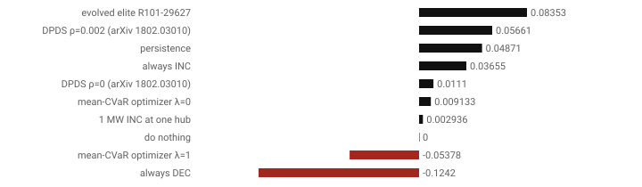

# evobots in two pages

## The question
Electricity in the US Midwest is priced twice: a day ahead (DA) and in real time (RT). A *virtual bid* is a purely financial bet on the gap between the two, at one place and hour. Can a computer search find a simple, readable betting rule that would have made money over 20 years of real prices? Would it have stayed alive with realistic capital and costs? And would it still work on years it never saw? If it can't, will it say so honestly?

## The approach
- **Data:** every price MISO (the Midwest grid operator) published from April 2005 to September 2025, for 1,500–2,600 locations. Also weather forecasts, gas prices and a policy-uncertainty index, each used only as it was known on the day. One later year is sealed away for a single final test.
- **The search:**
  - thousands of small trading programs are bred and mutated;
  - each is scored like a trading career: it starts with $1.5 million, sizes its bets by its own recent losses, pays fees, and dies if it runs out of money;
  - quality-diversity search (MAP-Elites) keeps the best trader of each *kind*, from always-buying to rarely-selling, not just one winner.
- **The judge:** before any trader is called deployable, it must pass eight gates, including:
  - surviving thousands of reshuffled histories;
  - showing skill beyond what luck would give after that many tries;
  - not being an overfitted winner;
  - making money with doubled costs, on an unseen year, through storms and on every location.
- **The comparison:** the same rules score everything else too:
  - simple baselines;
  - an optimiser that solves a linear program each day;
  - an online bidding algorithm from the research literature;
  - portfolios of evolved traders;
  - a battery that buys low and sells high.

## The key figures
- **The run:** 30,000 traders evolved over 15 rolling five-year windows.
- **The best evolved trader** grew capital by 8.7 % (log growth +0.084) on the unseen year, the highest of any strategy. It bets that day-ahead prices run high after expensive days in uncertain times.
- **But** after 27,167 tries, a result that good is what the luckiest random rule would show (deflated Sharpe 0.00). It also fails the overfitting test: the archive's in-sample winners mostly weren't out-of-sample winners (PBO 0.76).
- **A two-setting algorithm from the literature** (DPDS) grew 5.8 % with a deflated Sharpe of 0.98, because so few versions of it were tried.
- **Statistically, one year can't tell any of these strategies apart** (all are in the model confidence set).
- **The battery:** its best realistic policy earns 75 % of the hindsight optimum, using just yesterday's prices as the forecast.
- **Risk models:** the standard ones held up to 2021 and all failed in 2022–2025, when big losses came in clusters.
- **Price impact:** our own bets are too small to move prices measurably.

## The honest result
The system's decision is **"do nothing"**. That is the point:
- **It found a rule that looks great** (profitable, storm-proof, positive on the unseen year).
- **Then it showed why that isn't evidence of a real edge.** Twenty years of data can only detect a strong edge, and every extra rule tried raises the bar.

The remaining clean tests are the sealed year and paper trading on new data from 22 September 2026, which `evobots paper` runs whenever new MISO files are added.

## Where to look
- **The full write-up:** [report.md](report.md).
- **The formulas:** [maths.md](../maths.md).
- **The app:** `evobots serve`. Evolution, Traders, Report, Paper trading and the ORFE pages show all of the above interactively.
